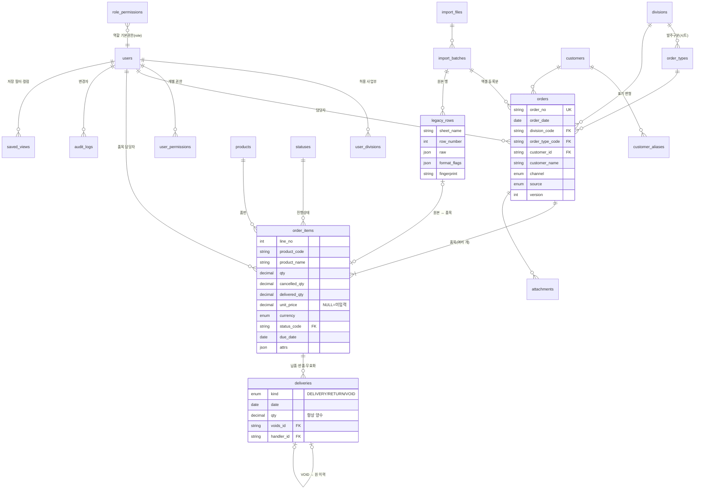

# 3단계: 데이터베이스 설계 및 관계도

> **실제 적용된 스키마: [`supabase/migrations/0001_init.sql`](../supabase/migrations/0001_init.sql)** (Supabase 프로젝트 `kiwon-order`, 서울 리전에 적용 완료)
> 화면용 타입: `src/lib/types.ts` — 필드 이름이 같습니다(camelCase).
>
> **2026-10-21 확정 사항 반영 (아래 본문보다 우선)**
> - 사업부 구분은 쓰지 않음 → `divisions`·`user_divisions` 테이블 없음. 엑셀 시트 출처만 `orders.order_type`(구분)으로 보존, 새 발주는 `GENERAL`(일반).
> - 발주번호: 직접 입력·일상 업로드 `KW-YYMMDD-NNN`(발주일 기준), 최초 이관 `L-{시트약어}-{원본행번호}`.
> - 노란색 행 = 완료 확정 → 이관 시 납품완료 처리 기본값 켬.
> - 납기일: 신규 발주 필수 입력, 임박(3일 이내)·지연 시 화면 알림.
> - 권한: 관리자 / 일반 직원(전체 등록·수정) / 조회 전용. 등록되지 않은 이메일은 가입 자체가 DB에서 차단됨.
> - 모든 쓰기는 DB 함수(create_order, update_item, add_delivery, void_delivery, import_commit 등)로만 가능. 테이블 직접 수정·삭제 권한 없음.
> - 상태 코드 테이블·첨부파일 테이블은 2차 개발로 미룸 (상태는 코드에 고정).
> **[제안]** 표시는 엑셀·요청서에 없는 규칙입니다.

---

## 1. 관계도



---

## 2. 테이블 정의

### 2-1. 사용자·권한

| 테이블 | 주요 컬럼 | 설명 |
|---|---|---|
| `users` | login_id, name, **aliases[]**, role(ADMIN/STAFF/VIEWER), is_active | aliases = 엑셀 담당자 표기 변형 (`신종현과장님` → 종현) |
| `role_permissions` | role, permission, allowed | 역할별 기본 권한 (예: `order.update`, `delivery.void`, `import.migration`, `admin.users`) |
| `user_permissions` | user_id, permission, allowed | 개인별 예외 |
| `user_divisions` | user_id, division_code | 등록·수정 가능한 사업부 |

권한 판정 = `user_permissions` 있으면 그 값, 없으면 `role_permissions`. **모든 판정은 서버에서** (아래 7절).

### 2-2. 코드 테이블 (관리자 수정)

| 테이블 | 초기값 |
|---|---|
| `divisions` | TOOLS 기원툴스 (접두 KT), MRO 기원MRO (접두 KM) |
| `order_types` | TOOLS 기원툴스 · MRO · MRO_SUPPLY MRO잡자재 · VIETNAM 베트남(USD) · STOCK 기원재고 · NTY 엔티와이반도체 — 각 `legacy_sheet_name` 으로 엑셀 시트와 연결. 베트남·기원재고·엔티와이의 사업부는 **확인 필요** (01 문서 Q4) |
| `statuses` | RECEIVED 접수 · CONFIRMED 발주확정 · IN_PRODUCTION 제작중/입고대기 · READY 납품준비 · PARTIAL 부분납품(자동) · DELIVERED 납품완료(자동, 종결) · ON_HOLD 보류 · CANCELLED 취소(종결) |
| `app_settings` | due_soon_days = 3, order_no_format … |

상태 `code` 는 집계 규칙이 쓰므로 고정, **이름·색·아이콘·순서·사용 여부만** 관리자가 수정합니다. 새 상태를 추가하면 `is_closed`(종결 여부)를 지정해 집계에 자동 반영 [제안].

### 2-3. 거래처·상품

| 테이블 | 주요 컬럼 | 비고 |
|---|---|---|
| `customers` | name, **normalized_name (UNIQUE)**, kind(B2B/ONLINE_PERSON/INTERNAL/OVERSEAS), contact, shipping_method, shipping_branch, memo | '업체 정보' 시트 130개가 출발점 |
| `customer_aliases` | customer_id, alias, normalized_alias (UNIQUE) | `MRO 재고`/`MRO재고`, `아이마켓(진양오일씰)`/`진양오일씰(아이마켓)` |
| `products` | code(PK 품번), barcode, name, spec, **category**, unit, last_price, currency | category = 엑셀 '바코드' 열에 들어있던 분류명 |

**거래처 중복 방지**: `normalized_name` = 소문자 + 공백 제거 + `(주)`, `주식회사`, `(유)` 제거. 등록 시 정규화 이름이 같거나 별칭과 같으면 차단, 비슷하면(편집거리) 경고 [제안].

### 2-4. 발주·품목·납품

| 테이블 | 주요 컬럼 |
|---|---|
| `orders` | order_no(UNIQUE), order_date, division_code, order_type_code, customer_id, **customer_name(원문)**, channel, requester, assignee_id, due_date, memo, **source**(MANUAL/EXCEL_DAILY/EXCEL_MIGRATION), import_batch_id, grouping_method, copied_from_id, is_hidden, **version** |
| `order_items` | order_id, line_no, product_code, barcode, product_name, spec, **qty, cancelled_qty, delivered_qty**, unit, **unit_price(NULL 허용)**, price_note, currency, assignee_id, due_date, status_code, supplier, memo, note, **attrs(JSON)**, legacy_row_id, version |
| `deliveries` | item_id, **kind**(DELIVERY/RETURN/VOID), date, qty(>0), voids_id, handler_id, memo, created_by — **수정·삭제 금지** |
| `order_no_sequences` | prefix(KT-261021), last_no |
| `attachments` | order_id, file_name, storage_key, mime_type, size, sha256 (2차) |

### 2-5. 감사 로그

| 테이블 | 주요 컬럼 |
|---|---|
| `audit_logs` | at, user_id, entity, entity_id, **order_id**, action, field, **before, after (JSON)**, request_id, ip |

- 추가만 가능: 앱 DB 계정에서 `UPDATE/DELETE` 권한 회수.
- 한 번 저장할 때 바뀐 필드마다 1행, 같은 `request_id` 로 묶어 상세 화면에서 "10/21 14:03 민구 — 수량 100→80, 납기 –→10/25" 처럼 표시.

### 2-6. 엑셀 업로드

| 테이블 | 주요 컬럼 | 역할 |
|---|---|---|
| `import_files` | file_name, **sha256 (UNIQUE)**, size, storage_key | 원본 파일 보관 + 같은 파일 재업로드 탐지 |
| `import_batches` | file_id, mode(MIGRATION/DAILY), status, sheets[], **mapping(JSON)**, total/inserted/updated/skipped/errors, error_report | 업로드 작업 이력 |
| `legacy_rows` | batch_id, **sheet_name, row_number, raw(JSON 셀 원문·타입·수식), format_flags(노란색·취소선·빨간글씨·셀메모)**, fingerprint, issues, result | 원본 행 보존 — 이관 규칙을 바꿔 다시 변환 가능 |

### 2-7. 사용자 화면 설정

| 테이블 | 주요 컬럼 |
|---|---|
| `saved_views` | user_id, screen, name, filters, columns(순서·표시·너비·고정), sort, page_size, is_default |

---

## 3. 계산 규칙

| 값 | 공식 | 비고 |
|---|---|---|
| 누적 유효 납품수량 | Σ DELIVERY.qty − Σ RETURN.qty − Σ(VOID 가 가리키는 이력의 부호 있는 수량) | VOID 된 DELIVERY 는 빼고, VOID 된 RETURN 은 다시 더함 |
| **미납수량** | `qty − cancelled_qty − 누적 유효 납품` | 요청서 공식 + 취소·마감수량 반영 |
| 금액 | `unit_price × qty` | unit_price NULL → 금액 NULL (합계에서 "미입력 N건" 별도 표시) |
| 원화 환산 금액 [제안] | 통화별 환율(설정) × 금액 | 통계 화면용, 2차 |
| 납기 지연 | `due_date < 오늘 AND 미납 > 0 AND status NOT IN (CANCELLED, ON_HOLD)` | 보류 제외는 [제안] |
| 납기 임박 | `오늘 ≤ due_date ≤ 오늘 + due_soon_days AND 미납 > 0` | |
| 품목 납기 | `item.due_date ?? order.due_date` | |
| 품목 담당자 | `item.assignee_id ?? order.assignee_id` | |
| 표시 상태 | 취소/보류 → 그대로 · 미납 0 → DELIVERED · 납품 > 0 → PARTIAL · 그 외 지정 상태 | 02 문서 1-1 |

`delivered_qty` 는 조회 속도를 위한 **캐시 컬럼**이며, 원본은 항상 `deliveries` 입니다. 납품 등록 트랜잭션 안에서 함께 갱신하고, 야간 점검 쿼리로 불일치를 검사합니다.

### 수량 변경·취소
- **수량 변경**: `qty` 를 바꾸면 audit_logs 에 before/after. 단, 새 qty < (유효납품 + 취소수량) 이면 거부.
- **품목 취소**: 남은 수량 전체를 `cancelled_qty` 에 더하고 status = CANCELLED. 이미 납품된 수량은 그대로 집계(매출 보존).
- **잔량 마감** (엑셀 '미납 수량 마감처리'): 남은 수량을 `cancelled_qty` 에 더하고 사유 필수 → 미납 0 → 납품완료.

---

## 4. 납품 초과 방지

이중으로 막습니다.

1. **트랜잭션 + 행 잠금** (애플리케이션)
   ```sql
   BEGIN;
   SELECT qty, cancelled_qty, delivered_qty FROM order_items WHERE id = $1 FOR UPDATE;
   -- delivered_qty + cancelled_qty + :new_qty > qty 이면 ROLLBACK + 오류 "최대 N개까지 납품 가능"
   INSERT INTO deliveries (...);
   UPDATE order_items SET delivered_qty = delivered_qty + :new_qty WHERE id = $1;
   INSERT INTO audit_logs (...);
   COMMIT;
   ```
2. **DB CHECK 제약** (최후 방어선, 마이그레이션 SQL 로 추가)
   ```sql
   ALTER TABLE order_items ADD CONSTRAINT chk_qty_pos       CHECK (qty > 0);
   ALTER TABLE order_items ADD CONSTRAINT chk_not_over      CHECK (delivered_qty >= 0 AND cancelled_qty >= 0 AND delivered_qty + cancelled_qty <= qty);
   ALTER TABLE order_items ADD CONSTRAINT chk_price_nonneg  CHECK (unit_price IS NULL OR unit_price >= 0);
   ALTER TABLE deliveries  ADD CONSTRAINT chk_dlv_qty_pos   CHECK (qty > 0);
   ALTER TABLE deliveries  ADD CONSTRAINT chk_void_ref      CHECK ((kind = 'VOID') = (voids_id IS NOT NULL));
   -- 납품이력 수정·삭제 차단
   CREATE TRIGGER deliveries_no_mutation BEFORE UPDATE OR DELETE ON deliveries
     FOR EACH ROW EXECUTE FUNCTION raise_immutable();
   ```
- 반품(RETURN)은 현재 유효납품 수량을 넘을 수 없음.
- VOID 는 한 이력에 한 번만 (`voids_id UNIQUE`), VOID 를 다시 VOID 하는 것은 금지 [제안].

---

## 5. 동시수정 충돌 처리 (낙관적 잠금)

1. 화면이 발주를 열 때 `version` 을 함께 받음 (예: v3).
2. 저장 요청에 `version = 3` 포함 → 서버는
   `UPDATE orders SET …, version = version + 1 WHERE id = $1 AND version = 3`
3. 바뀐 행이 0개면 **409 Conflict** + 현재 DB 값 반환.
4. 화면에 **변경 비교 창**: "다른 사용자(이슬, 14:05)가 먼저 수정했습니다" — 필드별 [내 값] / [저장된 값] 나란히, 항목별 선택 후 다시 저장.
5. 품목도 각자 `version` 을 가져 서로 다른 품목을 동시에 고치는 것은 충돌 없이 허용 [제안].
6. 납품 등록은 version 대신 4절의 행 잠금으로 처리 (두 명이 동시에 납품을 넣어도 합계가 초과되지 않음).

---

## 6. 발주번호 규칙 [제안]

| 구분 | 형식 | 예 |
|---|---|---|
| 기원툴스 | `KT-YYMMDD-NNN` | KT-261021-001 |
| 기원MRO | `KM-YYMMDD-NNN` | KM-261021-014 |
| 엑셀 최초 이관 | `L-{시트약어}-{행번호6자리}` (묶음 승인 시 첫 행 번호) | L-TOOLS-000318, L-VN-000092 |

- 일련번호는 `order_no_sequences` 에서 `INSERT … ON CONFLICT DO UPDATE SET last_no = last_no + 1 RETURNING last_no` 로 원자적으로 발급 → 동시 등록해도 중복 없음.
- 발주일이 아닌 **등록일** 기준 [제안] (과거 날짜로 등록해도 번호 순서 유지). 결정 필요.

---

## 7. 보안·권한 (서버 측)

| 항목 | 방법 |
|---|---|
| 인증 | Supabase Auth (이메일+비밀번호) 또는 자체 세션(bcrypt). 세션 쿠키 HttpOnly·Secure·SameSite=Lax |
| 권한 검증 | 모든 쓰기는 Next.js **Server Action / Route Handler** 에서 `requirePermission(user, 'order.update', divisionCode)` 후 실행. 화면의 버튼 숨김은 보조 수단일 뿐 |
| DB 계층 방어 [선택] | Postgres **RLS** (VIEWER 는 SELECT 만, STAFF 는 허용 사업부만 UPDATE) |
| 입력 검증 | 서버에서 zod 스키마로 재검증 (수량 > 0, 날짜 형식, 통화 코드, 문자열 길이) |
| 파일 업로드 | 확장자 + MIME + 매직바이트(xlsx = ZIP) 확인, 최대 20MB, 수식은 **값만 읽고 실행 안 함**, 매크로(xlsm) 거부, 비공개 버킷 저장, 서버에서 파싱 |
| 중요정보 | 개인 구매자 연락처는 목록에서 마스킹, 오류 메시지에 SQL·스택 노출 금지, `.env` 커밋 금지 |
| 감사 | 로그인·권한변경·삭제(숨김)·이관·설정 변경 모두 audit_logs |

---

## 8. 인덱스

| 대상 | 인덱스 | 용도 |
|---|---|---|
| orders | order_date / (customer_id, order_date) / assignee_id / (division, type) | 기간·거래처별 조회, "지난달 ○○ 거래처 발주량" |
| order_items | product_code / (assignee_id, status_code) / due_date / status_code | "특정 품번 이전 발주", 담당자별 미처리, 납기 지연 |
| order_items [제안] | `pg_trgm` GIN (product_name, spec) | 상품명·규격 부분검색 |
| deliveries | (item_id, date) / date | 납품이력, 일자별 출고 |
| audit_logs | (order_id, at) | 상세 화면 수정이력 |
| legacy_rows | fingerprint, (batch, sheet, row) UNIQUE | 중복 업로드 탐지 |

데이터량 예상: 연 4,200행 수준 → 10년 치도 수만 행이라 무료/저가 플랜으로 충분합니다.

---

## 9. 백업·복구

| 항목 | 방법 |
|---|---|
| 일일 백업 | Supabase Pro 자동 일일 백업(7일 보관) **+** 매일 새벽 `pg_dump -Fc` 를 별도 저장소(사내 NAS 또는 클라우드 버킷)에 30일 보관 |
| 시점 복구 [선택] | Supabase PITR 애드온 (실수로 대량 수정했을 때 분 단위 복구) |
| 업로드 원본 | import_files 스토리지 보관 → 이관을 다시 할 수 있음 |
| 복구 절차 | ① 테스트 프로젝트에 `pg_restore` ② 건수·합계 검증 쿼리 ③ 이상 없으면 운영 전환 |
| 복구 리허설 | 분기 1회 실제로 복구해 보고 걸린 시간 기록 |
| 이관 되돌리기 | import_batch 단위 '되돌리기' (해당 배치로 생성된 발주를 숨김 + 감사로그) — 납품이력이 추가된 뒤에는 관리자 확인 필요 |

## 10. 운영 / 테스트 분리

| | 개발 | 테스트(스테이징) | 운영 |
|---|---|---|---|
| DB | 로컬 Postgres 또는 Supabase dev 프로젝트 | 별도 Supabase 프로젝트 | 별도 Supabase 프로젝트 |
| 데이터 | 가짜 데이터 | 이관 리허설용 실제 데이터 사본 (접근 제한) | 실제 |
| 화면 표시 | "개발" 띠 | 주황 "테스트 데이터" 띠 | 표시 없음 |
| 환경변수 | `.env.local` | 배포 플랫폼 환경변수 | 배포 플랫폼 환경변수 (운영 키는 관리자만) |

운영 DB 변경·배포는 **승인 후**에만 진행합니다.
